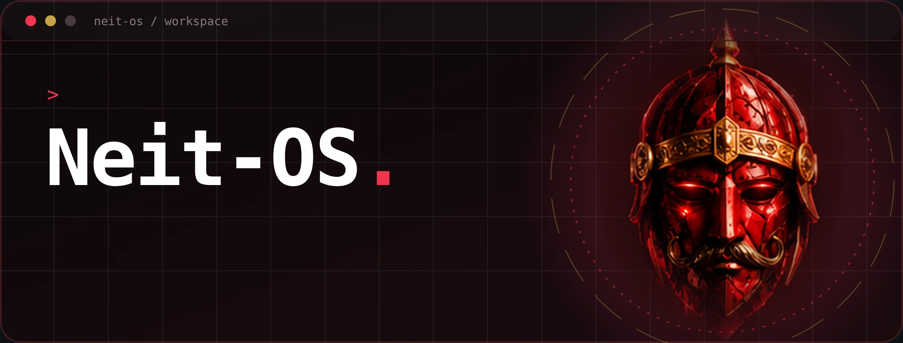

[README_1.md](https://github.com/user-attachments/files/34147473/README_1.md)

 

 

## 👋 Merhaba

**NEIT**, fikri tasarıma, tasarımı çalışan bir ürüne çeviren küçük bir **dijital yaratıcı stüdyo**.
Burada denemelerimi, yan projelerimi ve açık kaynak çalışmalarımı paylaşıyorum.

> Her proje yeni bir hikâye. İhtiyacı dinle, doğru stratejiyle sana özel çözüm üret.

 

## ⚔️ Neler yapıyorum

<table>
<tr>
<td width="50%" valign="top">

**🖥️ Web Uygulamaları**
Modern, ölçeklenebilir ve performans odaklı web uygulamaları.

**🎮 Oyunlar**
Etkileyici deneyimler sunan oyun projeleri.

**⚙️ Otomasyon**
İş süreçlerini kolaylaştıran akıllı otomasyon çözümleri.

</td>
<td width="50%" valign="top">

**🛡️ Siber Güvenlik**
Dijital varlıkları koruyan güvenlik çözümleri.

**🎨 UI/UX Tasarım**
Kullanıcı odaklı, estetik ve işlevsel arayüz tasarımları.

**🔴 Portfolyo**
Tüm bunları tek yerde toplayan [nivyxa.com](https://nivyxa.com) sitem.

</td>
</tr>
</table>

 

## 🧰 Araçlar

<!-- Kullanmadıklarını sil, kullandıklarını ekle: https://shields.io -->

 

## 📊 İstatistikler

 

## 📬 İletişim

Bir fikrin ya da projen mi var? **Birlikte hayata geçirelim.**

- 🌐 Site: [nivyxa.com](https://nivyxa.com)
- 📸 Instagram: [@neit._.studio](https://instagram.com/neit._.studio)
- 🐦 X: [@neitxtudio](https://x.com/neitxtudio)

 

